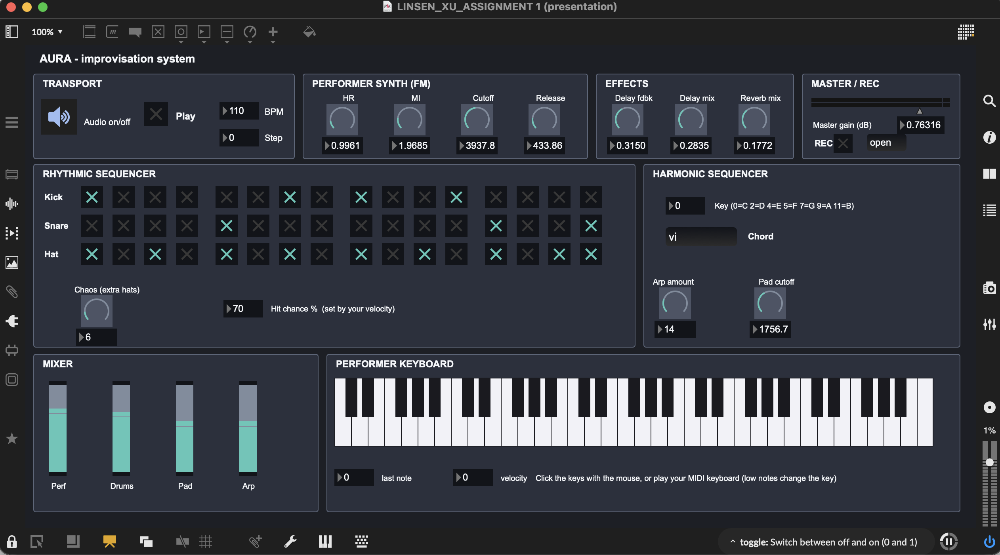
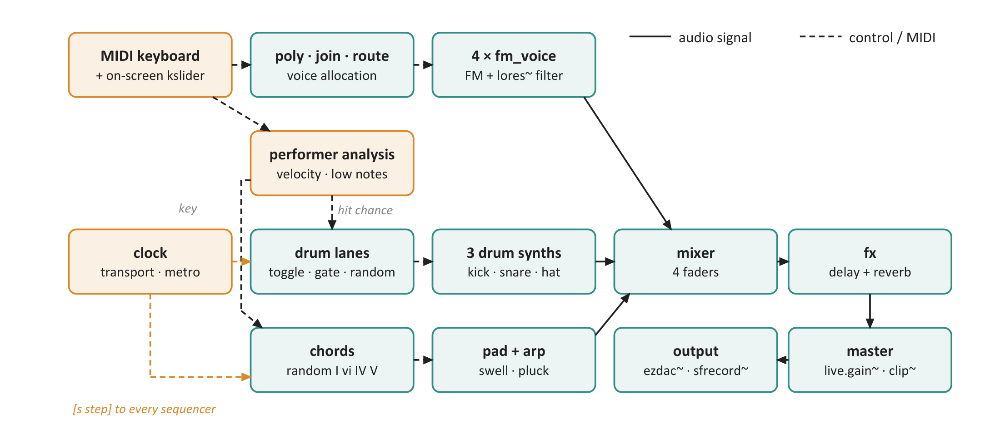

# AURA — Automated Improvisation System in Max/MSP

A single-file Max/MSP patch for live keyboard improvisation, developed for *Introduction to Max* (M.Phil. in Music and Media Technologies, Trinity College Dublin).

When a performer plays a MIDI keyboard (or the on-screen `kslider`), the system accompanies in real time with synthesised drums, chord pads, and an arpeggiator driven by a single shared clock. Rather than repeating fixed loops, both the rhythmic and harmonic layers use probabilistic decision logic shaped by live playing velocity and register.

- **Performance Demo Video (YouTube):** https://youtu.be/hIiYg0NwdhQ



## System Architecture



All sequencing runs from a single master `[transport]` and `[metro 16n]` driving a `[counter 0 15]`, broadcast via `[s step]` so that drums, harmony, and arpeggiation remain locked together under live tempo changes.

### Main Subpatches

- **Performer Synth (`4 × [p fm_voice]`)**: 4-voice polyphonic FM synthesis (`[poly 4 1]` → `[join 3]` → `[route 1 2 3 4]`), where each voice pairs a `[cycle~]` carrier/modulator (controllable Harmonicity Ratio and Modulation Index) with an `[adsr~]` envelope, summed into a shared `[lores~]` low-pass filter.
- **Rhythmic Sequencer (`[p drum_kick]`, `[p drum_snare]`, `[p drum_hat]`)**: Three 16-step toggle lanes (`[sel 0 ... 15]` → `[gate]`) gated by a probabilistic hit check (`[random 100] < p`). Performer note velocity (`[stripnote]` → `[scale 1 127 30 95]`) sets the live hit probability between 30% and 95%, so playing harder produces denser grooves while playing softly thins the texture. A `Chaos` dial (0–40%) injects probabilistic extra hi-hat hits on inactive steps. Drum voices are synthesised directly with `[cycle~]`, `[noise~]`, and `[line~]` envelopes.
- **Harmonic Sequencer (`[p chords]`, `[p pad]`, `[p arp]`)**: On step 0 of each bar, `[random 4]` selects a chord degree (`I`, `vi`, `IV`, or `V`) with a random minor/major third (`+3` or `+4` semitones) and fifth (`+7`). Performer notes below middle C (`[split 24 59]` → `[% 12]`) dynamically update the tonal centre. `[p pad]` voices the triad with three `[saw~]` oscillators through `[lores~]` and a swell/fade `[line~]` envelope; `[p arp]` probabilistically triggers high-register `[cycle~]` plucks on each sixteenth step.
- **Mixer, Effects & Master (`[p fx]`)**: Four `[line~]`-smoothed channel faders feed a stereo feedback delay (409 ms L / 545 ms R) and a dual-channel comb/allpass reverb, followed by a stereo `[live.gain~]` master fader, `[clip~]` limiter, `[ezdac~]`, and direct stereo recording via `[sfrecord~ 2]`.

## Repository Structure

```text
aura-max-improvisation/
├── aura_improvisation_system.maxpat   # Self-contained Max/MSP patch (Max 8/9)
├── assets/
│   ├── interface_presentation.png     # Presentation-mode UI
│   └── system_overview.png            # Audio & control signal-flow diagram
└── README.md
```

## Running the Patch

1. Open `aura_improvisation_system.maxpat` in **Cycling '74 Max** (tested on Max 8 / Max 9; uses only built-in Max/MSP objects, no external packages required).
2. Switch to **Presentation Mode** (`Cmd+Option+E` on macOS / `Ctrl+Alt+E` on Windows) if not already active.
3. Click the **Audio on/off** (`[ezdac~]`) button, toggle **Play**, and play on an external MIDI keyboard or the on-screen keyboard. Notes below C4 transpose the harmonic key centre; playing velocity controls drum hit density.

## Known Limitations & Future Work

- **Performer analysis** currently tracks only note velocity and low-register pitch class, without phrase segmentation, rhythmic density estimation, or chord recognition.
- **Polyphony**: the four FM voices are implemented as duplicated subpatches rather than a `[poly~]` abstraction so the project remains self-contained in a single `.maxpat` file; migrating to `[poly~]` would simplify maintenance and increase voice count.
- **Control & state**: adding `[pattrstorage]` presets and richer pitch-class harmonisation would allow structured transitions across longer live improvisations.
